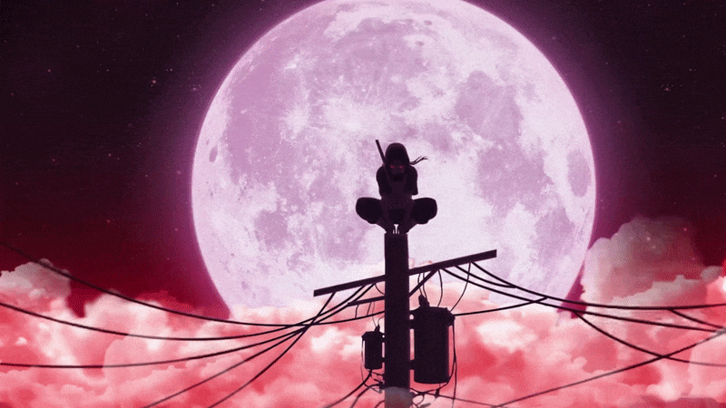

  

<h1 align="center">Hi 👋, I'm Anuja</h1>
<h3 align="center">A passionate developer from Sri Lanka 🇱🇰</h3>

  

## 👨‍💻 About Me

- 🌱 Currently learning and building projects
- 💻 Interested in software development
- 🎯 Always improving my programming skills
- 🇱🇰 From Sri Lanka

## 🛠️ Skills

  

## 📊 GitHub Stats

  
  

## 🔗 Connect

  

